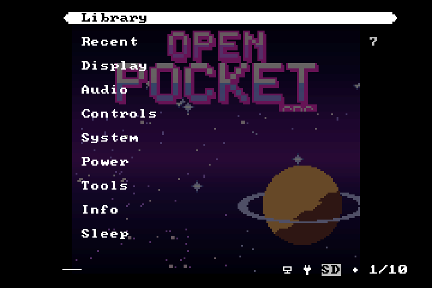
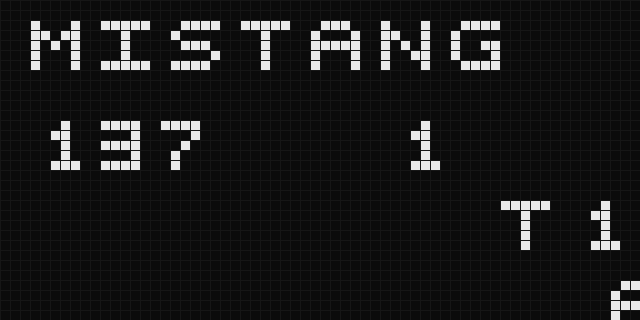
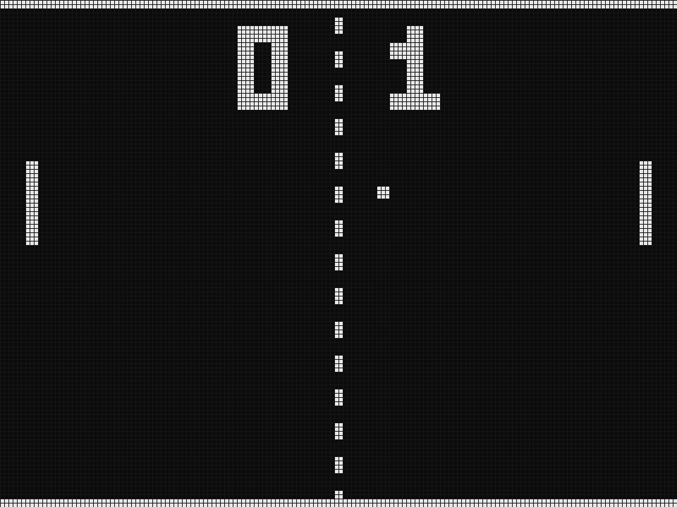

# MiSTang

Multi-core retro FPGA platform for the **Sipeed Tang Nano 20K** (GW2AR-18). Cores from SD card, flashing and HDMI capture from the browser.

**Site / Web Studio:** https://mistang-fpga.github.io/MiSTang/ · [Studio](https://mistang-fpga.github.io/MiSTang/studio/) · [How it works](https://mistang-fpga.github.io/MiSTang/how.html) · [Core catalog](https://mistang-fpga.github.io/MiSTang/cores.html)

## Status (2026-11-01)
| Piece | State |
|---|---|
| Web flasher: WebUSB → FT2232 MPSSE → Gowin JTAG, SRAM load, SPI-flash erase/write/verify | **Working, hardware-tested** (IDCODE, flash ID, 907 KB SRAM load in 4.8 s — same as openFPGALoader — 4 KiB flash write+verify+erase) |
| Web Studio: HDMI capture (UVC), serial remote, SD-card preparation | Written; capture/remote/SD prep not yet exercised on hardware |
| Core catalog (230 MiSTer cores + Tang ports, feasibility tiers) | Generated from the MiSTer docs; tiers are estimates, 5 are proven ports by others |
| `RECONFIG_N` multiboot switch from fabric | **Verified on the board** (`hwtest/reconfig`): pin 9 low → FPGA reloads from the header address |
| SD → flash → switch (launcher firmware) | Designed ([docs/design/launcher.md](docs/design/launcher.md)); launcher RTL/firmware not built yet |
| Ported cores | None yet. Candidates: NESTang, Open Pocket GBC/WS (existing), small 8-bit systems |

Nothing here claims a MiSTer core already runs on this board unless the catalog says *proven* and links the project that did it.

## Screenshots
Real captures from the board over USB-UART (`tools/capture_screen.py`, no capture card needed):



*Game Boy / Color core (Open Pocket GBC 1.9.1 bitstream, loaded with MiSTang's JTAG code), menu composite as sent by the board.*

## Core repositories
One core per repository, all built from the same [template](https://github.com/MiSTang-FPGA/mistang-core-template):
- [mistang-core-gbc](https://github.com/MiSTang-FPGA/mistang-core-gbc) — Game Boy / Color (from open-pocket-gbc)

- [mistang-core-ws](https://github.com/MiSTang-FPGA/mistang-core-ws) — WonderSwan / Color (from open-pocket-ws)
- [mistang-core-chip8](https://github.com/MiSTang-FPGA/mistang-core-chip8) — CHIP-8, written from scratch (CPU verified against a reference interpreter in simulation)
- [mistang-core-pong](https://github.com/MiSTang-FPGA/mistang-core-pong) — Pong, written from scratch (frame verified against a reference model in simulation)
- [mistang-core-apple1](https://github.com/MiSTang-FPGA/mistang-core-apple1) — Apple I style computer: 6502, monitor, 40x24 terminal (CPU and system verified against references in simulation)

Neither is hooked into the launcher yet. Policy: cores are the author's own (open-pocket-gbc / open-pocket-ws) or written from scratch here — no forks of other projects.

## Layout
```
docs/            GitHub Pages: site, Studio (docs/studio), catalog data
tools/           gen_catalog.py, gen_pages.py, mkcore.py, hw/ (node hardware tests)
tests/           node --test tests/core.test.mjs
```

## Use
- Studio: open the site in Chrome/Edge, *Connect board*, drop a `.fs`/`.bin`, *Load to SRAM*.
- Hardware tests from a shell: `cd build/hw && npm i usb`, then `node tools/hw/idcode.mjs`.
- Package a core for the SD card: `python3 tools/mkcore.py core.fs --id nes --name NES --ext nes -o out/`.

## Русский
Платформа для запуска разных ядер (в духе MiSTer) на Tang Nano 20K. Прошивка и захват экрана работают прямо из браузера (WebUSB), без Gowin IDE. Загрузка ядер с SD-карты построена на multiboot-переходе Gowin через `RECONFIG_N` (см. `docs/design/launcher.md`): код написан и спроектирован, но для проверки на плате нужна сборка RTL.

The JTAG/SPI command sequences in `docs/studio/gowin.mjs` follow the public Gowin protocol as implemented in openFPGALoader (re-written in JavaScript); no other third-party RTL is used.

## New cores (simulation frames; board screenshots come with the hardware pass)

| CHIP-8 | Pong |
|---|---|
|  |  |
